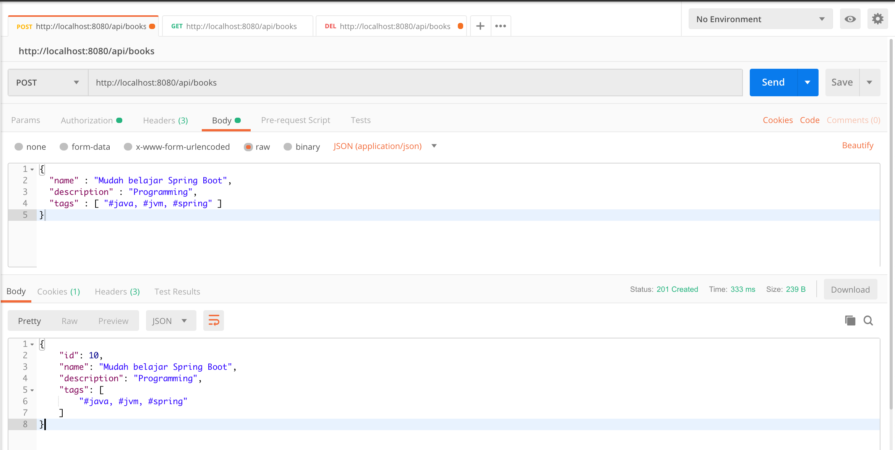
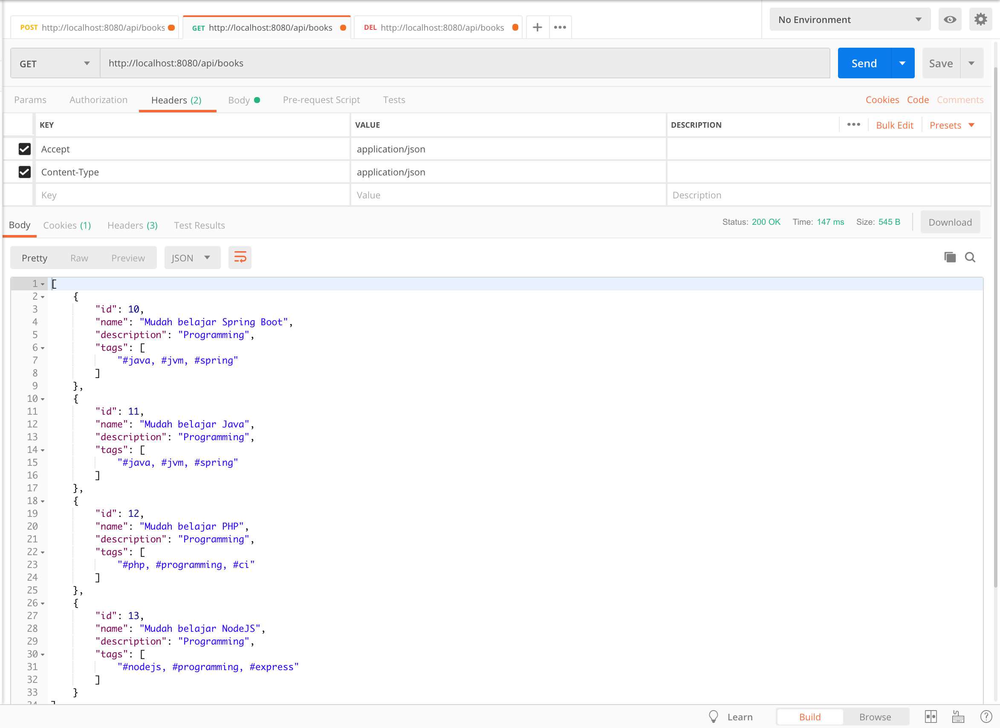
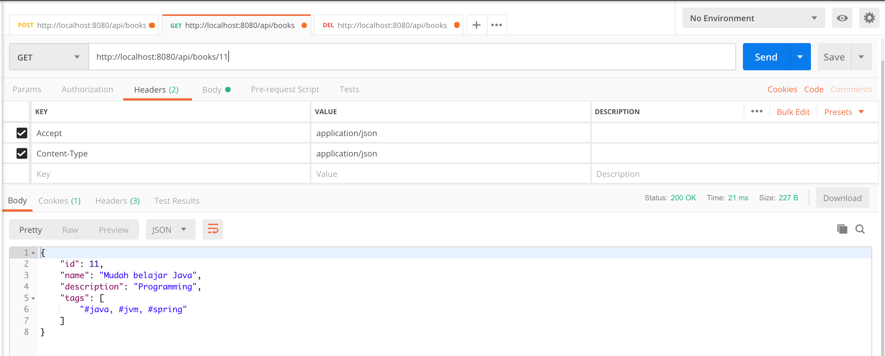
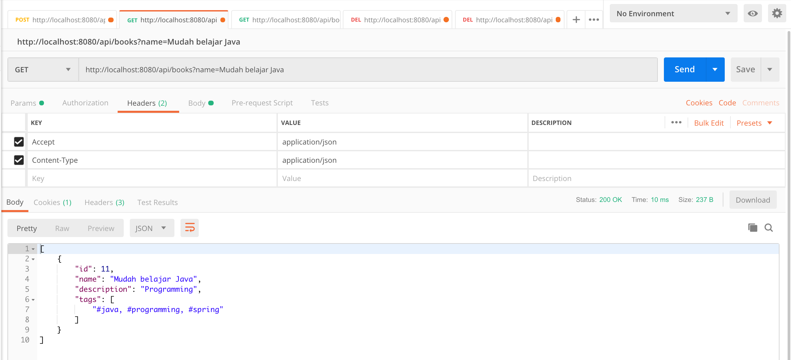
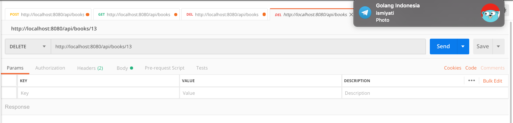
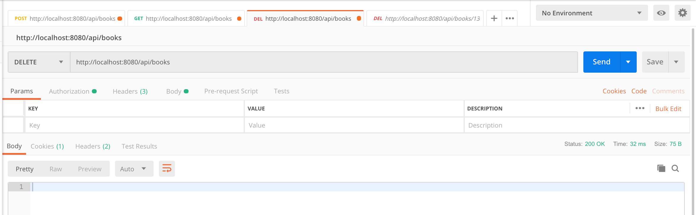

# spring-boot-rest-api-postgresql

[](https://github.com/hendisantika/spring-boot-rest-api-postgresql/actions/workflows/maven.yml)


#### Plain REST API CRUD with Spring Boot and PostgreSQL.

## Technology stack

* Java 25 (Eclipse Temurin)
* Spring Boot 4.1
* Spring Web MVC
* Spring Data JPA & Spring Data REST
* Hibernate
* PostgreSQL database
* Testcontainers 2 (integration tests)
* Maven (wrapper included)
* Docker

## Prerequisites

* JDK 25
* Docker (required to run the tests with Testcontainers and to run PostgreSQL locally)

## Getting started

### 1. Start PostgreSQL

```shell
docker run -d --name book-db \
  -e POSTGRES_DB=book_db \
  -e POSTGRES_USER=postgres \
  -e POSTGRES_PASSWORD=test \
  -p 5432:5432 \
  postgres:17-alpine
```

The connection settings live in `src/main/resources/application.yml`.

### 2. Run the application

```shell
./mvnw clean spring-boot:run
```

The API is available at http://localhost:8080/api/books.

### 3. Run the tests

```shell
./mvnw clean verify
```

Tests spin up a throw-away PostgreSQL container via Testcontainers (`@ServiceConnection`), so Docker must be running.

### 4. Build and run with Docker

```shell
./mvnw clean package -DskipTests
docker build -t spring-boot-rest-api-postgresql .
docker run -p 8080:8080 \
  -e SPRING_DATASOURCE_URL=jdbc:postgresql://host.docker.internal:5432/book_db \
  spring-boot-rest-api-postgresql
```

## CI/CD & dependency updates

* **GitHub Actions** (`.github/workflows/maven.yml`) builds and tests the project on JDK 25 for every push and pull request
  to `master`, then submits the Maven dependency graph to GitHub.
  Testcontainers uses the runner's Docker daemon by default; set the repository variable
  `USE_TESTCONTAINERS_CLOUD=true` (with a valid `TC_CLOUD_TOKEN` secret) to use Testcontainers Cloud instead.
* **Dependabot** (`.github/dependabot.yml`) keeps Maven dependencies (daily), GitHub Actions and the Docker base image
  (weekly) up to date, with grouped pull requests for Spring Boot, Testcontainers and minor/patch updates.

## API endpoints

| Method   | Endpoint                | Description       |
|----------|-------------------------|-------------------|
| `POST`   | `/api/books`            | Add new book      |
| `GET`    | `/api/books`            | Get all books     |
| `GET`    | `/api/books/{id}`       | Get book by id    |
| `GET`    | `/api/books?name=name`  | Get book by name  |
| `PUT`    | `/api/books/{id}`       | Update book by id |
| `DELETE` | `/api/books/{id}`       | Delete book by id |
| `DELETE` | `/api/books`            | Delete all books  |

Sample request body:

```json
{
  "name": "Naruto",
  "description": "Shinobi story",
  "tags": ["manga", "ninja"]
}
```

## Screenshots (Postman)

Add new Book



Get All Books



Get Book By Id



Get Book By Name



Delete Book By Id



Delete All Books


